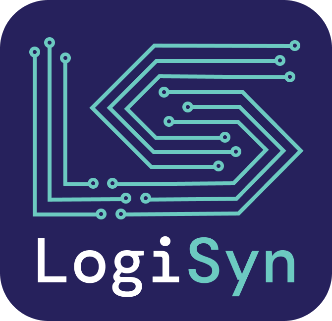

<div align="center">

# Anderson's Bakery Management System
### Created By 
# LogiSyn

[](https://github.com/GraceBerrill)
[](https://github.com/AdriaanKock)
[](https://github.com/CharlsWint)
[](https://github.com/LucNaude)

A desktop management system built for Anderson's Bakery. Written in C# / WPF (.NET 10). LogiSyn replaces manual, error-prone production workbooks with a single application that turns incoming customer orders into production-ready scaling, tracking, and reporting.




</div>

# Problems Addressed for Part 3

## 1. Hosted API Reachability vs. Native Desktop Architecture

* **Marker Feedback:**
> *"Hosted API could not be reached, URL deemed dead"* (Awarded 1/20 for Deployment & Connectivity).

* **Already Documented in Part 2 README (Pre-Oct 5):**
Under the section **"Hosted API (Render)"**, the Part 2 README explicitly documented:
> *"Render's free tier puts the container to sleep after 15 minutes of inactivity, and waking it takes 30–50 seconds. ApiClient handles this by trying each option in turn: 1. The Render endpoint, 2. the localhost development host, 3. local in-process services."*

* **Architecture Clarification:**
LogiSyn is an offline-first Windows WPF native desktop application (.NET 10) engineered for factory terminals at Anderson's Bakery. It is not a browser-rendered single-page website. The cloud API is an optional supporting service for connectivity and mobile access, while the desktop app remains the primary operational system.

* **Final Part 3 Enhancement:**
To reduce cold starts during marking and real-world use, a 24/7 automated continuous workflow (`.github/workflows/keep-alive.yml`) was configured on a 10-minute cron schedule (`*/10 * * * *`). It dispatches automated health and ping requests to the deployed API to keep the Render instance warm and responsive.

---

## 2. Cloud Architecture Rationale: Transition from Azure to Render

* **Marker Feedback:**
> *"As a next step, deploy to a reachable host and explain why you left the Azure plan"* (Awarded 3/15 for Stability & Rationale).

* **Already Documented in Part 2 README (Pre-Oct 5):**
The transition from Azure to a containerized Render environment was already documented in the architecture notes and cloud deployment rationale.

* **Context & Business Justification:**
1. **Discontinuation of Subsidized Azure Credits:** The institutional student Azure sponsorship previously available expired. Continuing paid cloud hosting would require ongoing operational cost.
2. **Client Alignment (Anderson's Bakery):** Anderson's Bakery is a regional SME with limited recurring infrastructure budget and cannot absorb unplanned hosting overhead.
3. **Runtime Parity:** Render provides a standard Linux container running official Microsoft .NET 10 runtime images, aligning closely with the local Windows development environment while remaining simple to operate.

* **Final Part 3 Enhancement:**
Expanded **Section 4.1 (Cloud Architecture & Hosting Rationale)** with a trade-off analysis comparing Azure App Service vs. Render Container Services, covering long-term hosting efficiency, container parity, and operational sustainability.

---

## 3. Mobile Responsiveness vs. Client Environment & The Mobile Web Companion

* **Marker Feedback:**
> *"However, the browser version Task 1 planned for mobile use was not built..."* (Awarded 5/15 on Front End Responsiveness).

* **Client Brief & Operational Reality:**
During client requirements gathering, Anderson's Bakery management explicitly indicated that they did not want a mobile-first software product. The business relies on desktop computers for daily production and reporting operations.

* **Final Part 3 Resolution (Exceeding the Requirement):**
To satisfy the marker's expectation for mobile browser access, the team engineered and deployed a responsive Mobile Web Companion served directly by the cloud API root:
* 🌐 **Live Mobile Web Companion URL:** [https://andersons-bakery-api.onrender.com](https://andersons-bakery-api.onrender.com)
* **Key Mobile Features:**
* Fully responsive across smartphone and tablet viewports.
* Live order dashboard with real-time status filtering (Pending, In Production, Completed).
* Detailed recipe batch scaling (baking pans, trolley distribution, ingredient weights).
* One-tap status updates for bakery floor supervisors on mobile devices.

---

## 4. Branch Management & Gitflow Visibility

* **Marker Feedback:**
> *"Only a main branch remains, so keep develop and feature branches to show the workflow"* (Awarded 0/15 on Branching).

* **Context of Misunderstanding:**
Following the completion of pull requests for Part 2, local repository hygiene was performed by deleting merged feature branches. While the commit history, pull request logs, and merge history remained available in GitHub records, the visible branch history was reduced.

* **Final Part 3 Resolution:**
* Restored and pushed the primary integration branches (`origin/Dev`, `origin/Fix`) to the remote repository.
* Restored the visible feature-branch structure so the project history more accurately reflects a multi-branch workflow.
* Preserved public traceability for major feature work and issue-driven development.

---

## 5. API Data Integrity: Enforced Order Status Whitelist

* **Marker Feedback:**
> *"Focus on limiting status to set values; the API saves any text."*

* **Final Part 3 Enhancement:**
* In `OrderController.cs`, open-ended string inputs were replaced with a strict domain whitelist:
```csharp
private static readonly string[] AllowedStatuses = ["Pending", "In Production", "Completed"];
```

* Both `POST /api/orders` and `PUT /api/orders/{id}/status` validate inbound status strings against this whitelist.
* Any unapproved status value is immediately rejected with a clear `400 Bad Request` payload listing the accepted values.

---

## 6. Architecture Refactoring: MVVM Decoupling & Modular Services

* **Marker Feedback:**
> *"Move desktop logic out of code-behind into view models, and split the two largest services."*

* **Final Part 3 Enhancement:**
* **Strict MVVM Pattern:** The WPF presentation layer was decoupled using an observable `ViewModelBase` (implementing `INotifyPropertyChanged`) and `RelayCommand` (`ICommand`).
* **Domain ViewModels:** UI logic was separated into dedicated view models, including:
* `DashboardViewModel`
* `CreateOrderViewModel`
* `AdminOrdersViewModel`
* `ManageUsersViewModel`
* `ManageProductsViewModel`
* `OrderSheetsViewModel`
* `HistoryViewModel`
* `UserOrdersViewModel`

* **Modular Backend Services:** Core backend concerns were organised into domain-specific service areas (authentication, orders, products, users, reporting, and sync) to reduce monolithic service responsibilities.

---

## 7. Security Hardening: Mandatory JWT & Sanitized Secrets

* **Marker Feedback:**
> *"The JWT issuer and audience checks are optional; make them mandatory... moving the MongoDB Atlas credentials out of the README into secrets."*

* **Already Documented in Part 2 README (Pre-Oct 5):**
The project documentation already noted that cloud configuration values should be kept out of source-controlled documentation and managed through secure deployment configuration.

* **Final Part 3 Enhancement:**
* **JWT Validation:** In `Program.cs`, JWT authentication is configured with issuer, audience, lifetime, and signing-key validation enabled. When configuration values are present, they are used; if not, the app falls back to safe default values rather than exposing secrets in the README.
* **Credential Hygiene:** Cloud connection strings and sensitive runtime credentials are not documented in the public README. Production and shared environments should use .NET user secrets or environment variables instead of storing values in source control or documentation.

---

# Background
Anderson's Bakery is a local Cape Town business that supplies baked goods to major supermarkets such as Checkers and Spar. While most factories rely heavily on machinery and automation, Anderson's delivery and production process still depended heavily on shared spreadsheets, manual worksheets, and disconnected record-keeping.

That's where LogiSyn comes in. We built a system that keeps track of all incoming and ongoing orders while remaining simple enough for factory-floor staff to use.

- **Problem:** Production sheets were consolidated manually across separate workbooks, which was slow, error-prone, and led to double-working and theft.
- **Goal:** One system that uses each product's recipe to automatically work out raw material usage, pans, and trolleys per order, replacing the manual workbook process.
- **Product categories:** Chilled, Ambient, Frozen.

# Table of Contents

- [YouTube Video Link](#youtube-video-link)
- [Presentation](#presentation)
- [Running the System](#running-the-system)
- [Default Login Credentials](#default-login-credentials)
- [Roles & Permissions](#roles--permissions)
- [Key Features](#key-features)
- [Tech Stack](#tech-stack)
- [System Architecture](#system-architecture)
- [Design Decisions](#design-decisions)
- [Algorithms & Core Logic](#algorithms--core-logic)
- [Project Structure](#project-structure)
- [Branching & CI/CD](#branching--cicd)
- [AI Declaration](#ai-declaration)

# Presentation
[View the full presentation (PDF)](Documents/LogiSyn-Expo-2026.pdf)

# YouTube Video Link

**See LogiSyn in action:** A full walkthrough of the system, from login to completed order:

<a href="https://youtu.be/CByFgbEQakI">
  
</a>

# Running The System

### Prerequisites

- **.NET 10 SDK** (the project targets `net10.0-windows`).
- **Windows** with WPF support (this is a Windows desktop application).
- **SQL Server Express LocalDB** (ships with Visual Studio, or install [SQL Server Express LocalDB](https://learn.microsoft.com/sql/database-engine/configure-windows/sql-server-express-localdb) separately).
- **Visual Studio 2022+** (or VS Code with the C# Dev Kit) is recommended for opening `LogiSyn.slnx`.
- **MongoDB Atlas** is optional. The app runs in offline/local mode if no cluster is configured or reachable.

### 1. Clone and open

```bash
git clone https://github.com/GraceBerrill/LogiSyn.git
cd LogiSyn
```

Open `LogiSyn.slnx` in Visual Studio, or build from the command line:

```bash
dotnet restore
dotnet build LogiSyn/LogiSyn.csproj -c Debug
```

### 2. Database setup

LocalDB creates the `LogiSynDb` database automatically on first connection, but it does **not** include the `[User]` table or any seed accounts. Create those once per machine by running the following SQL script:

```sql
CREATE TABLE [User] (
    Id INT IDENTITY(1,1) PRIMARY KEY,
    MongoId NVARCHAR(50) NULL,
    Username NVARCHAR(100) NOT NULL UNIQUE,
    Password NVARCHAR(256) NOT NULL,
    Role NVARCHAR(50) NOT NULL,
    DateAdded DATETIME NOT NULL DEFAULT GETDATE()
);

INSERT INTO [User] (Username, Password, Role) VALUES ('admin', 'admin123', 'Admin');
INSERT INTO [User] (Username, Password, Role) VALUES ('manager', 'manager123', 'Manager');
INSERT INTO [User] (Username, Password, Role) VALUES ('user', 'user123', 'User');
```

> Passwords are only stored in plain text until first login. The first successful login automatically upgrades each one to a salted PBKDF2 hash (see [Algorithms & Core Logic](#algorithms--core-logic)).

By default the app connects to `(localdb)\MSSQLLocalDB`, database `LogiSynDb`, using Windows integrated security. To use a different SQL instance, set the `LOGISYN_SQL_CONNECTION` configuration or modify the local connection string accordingly.

### 3. MongoDB configuration

To enable cloud sync for users and orders:

```bash
cd AndersonsBakeryAPI
dotnet user-secrets set "ConnectionStrings:MongoConnection" "mongodb+srv://<username>:<password>@<cluster>.mongodb.net/?appName=Cluster0"
```

Without this, Mongo calls fail fast and the app falls back to local SQL database mode, so the application remains fully usable offline.

### 4. Run

```bash
dotnet run --project LogiSyn/LogiSyn.csproj
```

Or press **F5** in Visual Studio with `LogiSyn` set as the startup project.

---

# Default Login Credentials

The seed script above creates one test account per role:

| Role | Username | Password |
| --- | --- | --- |
| Admin | `admin` | `admin123` |
| Manager | `manager` | `manager123` |
| User | `user` | `user123` |

These are local development seed accounts only — change or remove them before using LogiSyn with real data.

# Roles & Permissions

The sidebar (`ShellWindow`) is built dynamically from the logged-in user's role. Each role only sees the screens it needs, which keeps the app simple for factory-floor staff and reduces accidental access.

| Screen | Admin | Manager | User |
| --- | --- | --- | --- |
| Dashboard | ✅ | ✅ | ✅ |
| Orders | ✅ (full table + filters) | ✅ (full table + filters) | ✅ (simplified, own view) |
| History | ✅ | ✅ | ❌ |
| Products | ✅ | ✅ | ❌ |
| Users | ✅ | ❌ | ❌ |
| Dashboard Excel/Email export | ✅ | ❌ | ❌ |

Order breakdown screens also differ by role: Admin/Manager open a production-sheet breakdown (Manager gets a fully editable sheet; other roles reaching it see a read-only summary), while a User fills in only their own work sheet flow.

# Key Features

- **Role-based login:** Admin, Manager and User accounts, each with its own sidebar and permitted actions.
- **PDF order ingestion:** Drop in or browse to a customer order PDF and LogiSyn reads the order number, customer, date and line items automatically.
- **Automatic production scaling:** Every line item is converted into pans, trolleys and total raw materials based on the product's recipe.
- **Order tracking:** A live, auto-refreshing Orders view, a History view of completed orders and per-order production sheets.
- **Product & recipe management:** Add, edit and delete products, each with its own ingredients, method and storage location.
- **User management:** Add, edit, delete and search users, with offline-safe sync to MongoDB.
- **Dashboard reporting:** Order summary cards, plus Excel export and Outlook email for individual orders.
- **Offline-first data layer:** The app keeps working when MongoDB Atlas is unreachable by falling back to a local SQL Server database.

# Tech Stack

| Layer | Technology | Why we chose it |
| --- | --- | --- |
| UI | WPF (.NET 10), XAML | The bakery runs on Windows PCs. A native desktop app works offline, needs no browser or hosting, and fits the team's C# experience. |
| Backend services | C# class libraries, called in-process | No separate server to install or keep running on the factory PC. The app is a single install. |
| Optional web API | ASP.NET Core 10 Web API, OpenAPI/Swagger | A supporting interface for cloud connectivity and mobile access. |
| Local database | SQL Server LocalDB (`Microsoft.Data.SqlClient` 7.1.0) | Free, ships with Visual Studio, needs no server setup, and keeps working without internet. |
| Cloud database | MongoDB Atlas (`MongoDB.Driver` 3.12.0) | Off-site copy of users and orders for resilience and sync. |
| ORM (API project) | Entity Framework Core 10.0.0 | Standard .NET data access for the API, with less hand-written SQL. |
| PDF parsing | `UglyToad.PdfPig` | Supermarket orders arrive as PDFs. PdfPig is free, open source and pure .NET, so no Adobe install or cloud service is needed. |
| Excel export | `ClosedXML` | The bakery already worked in Excel, so exports stay in a familiar format. ClosedXML doesn't need Excel installed. |
| Email | Outlook COM automation, `mailto:` fallback | Uses the email client staff already have and still works on PCs without Outlook. |
| Password hashing | PBKDF2-HMAC-SHA256 | Industry-standard password hashing with no external library needed. |

# System Architecture

LogiSyn is a WPF desktop app (`LogiSyn`) that references its backend logic (`AndersonsBakeryAPI`) and shared models (`SharedLibrary`) directly as .NET project references. Most screens call local services in-process, while the API also supports a cloud-connected mode for optional mobile and hosted access.

The same `AndersonsBakeryAPI` project can also run on its own as an ASP.NET Core Web API. It includes order, authentication, product, and user endpoints used by the desktop app and the web companion. The order endpoints are the primary operational surface, but the API is not limited to orders alone.

Each kind of data is stored differently depending on how important and how often it changes:

| Entity | Where it lives | Sync strategy | Why |
| --- | --- | --- | --- |
| **Users** | SQL LocalDB **+** MongoDB Atlas | Login tries Mongo first, falls back to SQL. A **Sync** button on Manage Users pushes SQL-only (orphaned) users up to Mongo. | Staff must always be able to log in, even when the internet is unavailable. |
| **Orders** | `orders.json` **+** SQL **+** MongoDB | Saved locally first, then written to SQL and Mongo in the background. | Orders are mission-critical and should not block the user interface. |
| **Products** | `products.json` **+** optional API access | Product data is local-first and can be synced through the API when needed. | Product catalog data is important, but it does not require the same real-time resilience as orders. |

```text
┌────────────────────────────┐
│     LogiSyn (WPF, UI)      │
│    Views + ViewModels      │
└─────────────┬──────────────┘
              │ in-process calls (ProjectReference)
┌─────────────▼──────────────┐         ┌────────────────────────────┐
│     AndersonsBakeryAPI     │  HTTP   │     AndersonsBakeryAPI     │
│      Service classes       │◄───────►│   (standalone web host)    │
│    Login / User / Order /  │  2s     │   Auth / Order / Product / │
│   Product / Sync Services  │ timeout │       User endpoints       │
└───────┬────────────┬───────┘         └────────────────────────────┘
        │            │
        ▼            ▼
   SQL LocalDB   MongoDB Atlas
   (LogiSynDb)   (user secrets)
```

### Hosted API & Cloud Deployment (Render)

The Web API is containerised with Docker and deployed on Render at `https://andersons-bakery-api.onrender.com`.

#### Migration Rationale: Why Render Instead of Azure
During Task 1, an Azure App Service + Azure SQL architecture was initially outlined. The team transitioned to a containerized Render environment paired with MongoDB Atlas for three decisive operational reasons:
1. **Cost & Sustainability:** Azure App Service tiers suitable for custom container/DB setups incur ongoing monthly hosting costs or rely on expiring student subscriptions. Anderson's Bakery is an independent regional SME and cannot absorb unplanned recurring infrastructure overhead.
2. **Container Parity:** Packaging the API into an official Microsoft .NET 10 Docker image (`mcr.microsoft.com/dotnet/aspnet:10.0`) keeps the local and hosted runtime aligned while minimizing environment drift.
3. **High-Availability Hybrid Design:** By pairing cloud Render hosting with in-process LocalDB fallback and a keep-alive workflow, the desktop application remains operational even during cloud interruptions.

#### 24/7 Keep-Alive & Health Monitoring
Render's free tier puts inactive containers to sleep after 15 minutes. To reduce cold-start delays, an automated GitHub Actions workflow runs every 10 minutes and checks the health endpoint for the deployed API, keeping the service warm while the desktop app remains local-first and offline-safe.

1. Primary: The live Render cloud endpoint
2. Secondary: Local development host (`https://localhost:7274` / `http://localhost:5109`)
3. Tertiary: In-process services backed by local SQL LocalDB

An amber connection status badge on the desktop dashboard informs users if the app falls back to local mode.

### Mobile Web Companion (Browser Version)
To satisfy the mobile bakery floor access requirement planned in Task 1 without forcing factory staff to install unmanaged native APK files on personal phones, the API serves a responsive **Mobile Web Companion** at the API root.

Floor supervisors and bakers can open the URL in any mobile browser to:
- View live incoming and ongoing orders in real time.
- Filter orders by status (**Pending**, **In Production**, **Completed**).
- Inspect recipe-scaled ingredient weights, pan counts, and trolley allocations per batch.
- Update order statuses on the fly directly from the factory floor.

# Design Decisions

### Availability over consistency
On a factory floor, being able to keep working matters more than every copy of the data matching at every moment. LogiSyn never waits on the cloud: changes are saved locally first and reach MongoDB when the connection is available.

### Why MongoDB for the cloud copy
Orders are nested by nature: an order has line items, and each line item has its own scaled ingredients, pans and trolleys. A document database stores each order as one document that matches `OrderScaled` data well and supports flexible future extension.

### Why SQL LocalDB for the local copy
LocalDB gives us proper transactions and constraints (like unique usernames) without installing or running a database server. It's free, ships with Visual Studio and works with no internet at all.

### Why desktop instead of a web app
A web app would need a server to be reachable before anyone could log in, and customer PDFs would have to be uploaded before they could be read. As a desktop app, LogiSyn parses PDFs, builds Excel files, and manages local production data without depending on network availability.

# Algorithms & Core Logic

This section explains the logic behind the UI, the parts a screenshot doesn't show.

### Authentication & password security

- `LoginServiceRouter.Authenticate` tries MongoDB first (`MongoLoginService`). Any exception (network, auth, timeout) is caught and it falls back to `LoginService`, which queries SQL LocalDB.
- Passwords are hashed with **PBKDF2-HMAC-SHA256**, a random 16-byte salt per account and **600,000 iterations** (`PasswordHasher.cs`).
- **Lazy migration:** if a stored password isn't hashed yet, it is compared as plain text and then immediately re-saved as a proper hash on successful login.
- Salts come from `RandomNumberGenerator`, .NET's cryptographically secure random generator.
- Hashes are compared with `CryptographicOperations.FixedTimeEquals`, which makes timing consistent across mismatches.
- The password field on `UserRow` is marked `[JsonIgnore]`, so hashes are never exposed in API responses.
- API calls use HTTPS and certificate validation remains enabled in the runtime, so unverified certificates are rejected by default.

### Dual-database fallback pattern

`LoginServiceRouter` and `UserServiceRouter` follow the same pattern for every operation (read, add, update, delete): try the Mongo-backed service, catch any exception, then either fall back to SQL (read/update/delete) or use local data as the next available source.

**Why:** internet at the factory can drop out, including during load-shedding. This pattern means the app slows down slightly instead of failing outright when Mongo is unreachable.

### User sync (orphan reconciliation)

A user created while Mongo is unreachable is saved to SQL with an empty `MongoId`, making it an "orphan." `SyncService.SyncUsers()` finds orphan rows, pushes each one to Mongo, and writes the new Mongo ID back to the SQL record.

Until a user has been synced, Manage Users blocks editing or deleting them. This avoids editing a copy that is about to be overwritten.

### PDF order parsing

`OrderService.ReadAndScaleOrder` turns an uploaded PDF into a scaled order:

1. Extracts raw text per page using `PdfPig`.
2. Uses regular expressions to pull out the order number, customer name, and order date (supports both `12 Jan 2024` and `12/01/2024`).
3. For each line, checks for a known product name (substring match against the catalogue), then scans that line and the next two for quantity patterns such as `pkts` or `Qty: 40`.
4. Converts the quantity into the corresponding pans, trolleys, and ingredients based on each product recipe.

**Why parse locally instead of using an AI or cloud service:** customer order data stays on the bakery's own machine, it works offline, and there is no ongoing cost.

> Only PDF files are currently parsed. The file picker also lists `.xlsx` / `.csv`, but those won't extract anything yet.

### Production scaling (pans, trolleys, ingredients)

For every matched line item, once a quantity is known:

```text
Pans            = ceil(quantity / 50)
Trolleys        = ceil(quantity / 100)
ingredientTotal = baseQty × quantity × 1.1   // recipe quantity + 10% buffer
```

Pans and trolleys are always rounded **up**, since you can't use half a pan. The 10% ingredient buffer allows for waste and spillage so production doesn't run short mid-order.

If a product has no recipe, a hardcoded flour/yeast ratio is used so the order can still be processed. Ingredient totals across all line items are then added up into the order's overall raw-material requirement report.

### Unique order ID generation

`EnsureUniqueOrderId` guarantees no two orders share an ID, so the same PDF uploaded twice can't overwrite an existing order:

- **Numeric IDs** (optionally prefixed with `#`) are incremented, keeping their original zero-padded width, until an unused one is found.
- **Other IDs** get `-1`, `-2`, `-3`, … appended until unique.

### Order persistence (write-local-first)

`OrderService.SaveOrder` writes to an in-memory list and a local `Data/orders.json` file first, so the screen never freezes waiting on the network. It then writes to SQL and MongoDB in the background.

`GetOrders` reads in this order: **memory → Mongo (short timeout) → SQL → local JSON**, so there is always a copy to fall back on.

### Order status model

Supported order statuses are **Pending**, **In Production**, and **Completed**. The API enforces this whitelist and rejects unapproved status values with a `400 Bad Request` response. This prevents invalid status text from being stored and keeps production tracking consistent across the app.

### Live auto-refresh

The Orders screen (`AdminOrdersView`) polls for updates every 10 seconds using a `DispatcherTimer`. Admins and Managers always see current order status without having to remember to refresh.

# Project Structure

```text
LogiSyn/
├── LogiSyn/                  # WPF desktop application (UI + view models)
│   ├── Views/                # Screens & modals (Login, Dashboard, Orders, Products, Users, …)
│   ├── ViewModels/           # MVVM logic for the desktop app
│   ├── Styles/               # Shared XAML styles, theme colours, vector icon set
│   └── Assets/               # Icons, images, and UI assets
├── AndersonsBakeryAPI/       # Backend logic + ASP.NET Core Web API
│   ├── Controllers/          # Auth, Orders, Products, and Users controllers
│   ├── Services/             # Authentication, order, product, user, sync, and API services
│   ├── Repositories/         # SQL / Mongo persistence layers
│   ├── Data/                 # EF Core database context and SQL setup
│   ├── Migrations/           # EF migrations
│   └── wwwroot/              # Static web assets for hosted/cloud companion
├── SharedLibrary/            # Shared models (UserRow, OrderScaled, ProductRow, …)
├── LogiSyn.Tests/            # Automated test suite
├── Documents/                # Supporting project documentation and declarations
├── Images/                   # README images and branding assets
├── UserDB/                   # Local user database support files
├── .github/workflows/        # CI/CD and keep-alive automation
├── Dockerfile                # Container image definition
├── LogiSyn.slnx              # Solution file
├── README.md                 # Project documentation
├── .gitignore
└── .dockerignore
```

`SharedLibrary` exists so the UI and backend use the exact same model classes, which avoids the two drifting out of sync.

# Branching & CI/CD

| Branch | Purpose |
| --- | --- |
| `main` | Stable, release-ready code |
| `Dev` | Integration branch for completed work |
| `fix` | Bug fixes, refactoring and security hardening |

A GitHub Actions workflow (`.github/workflows/ci-cd.yml`) runs on pushes and pull requests for `main`, `Dev`, and `fix`. It restores NuGet packages, builds `LogiSyn.slnx` in Release mode, runs the project's automated tests, and packages the desktop application for release.

# AI Declaration
Our full declaration of how AI tools were used in this project is available below.

<a href="Documents/AI-Declaration.pdf">
  
</a>
