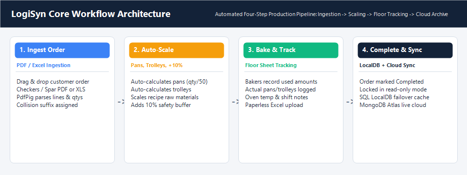
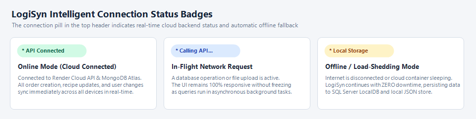
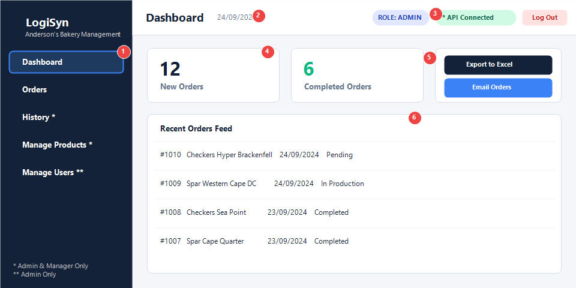
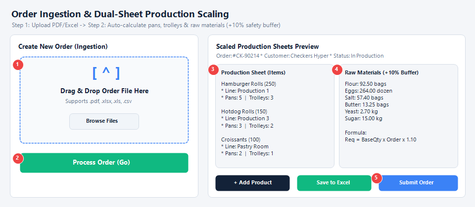
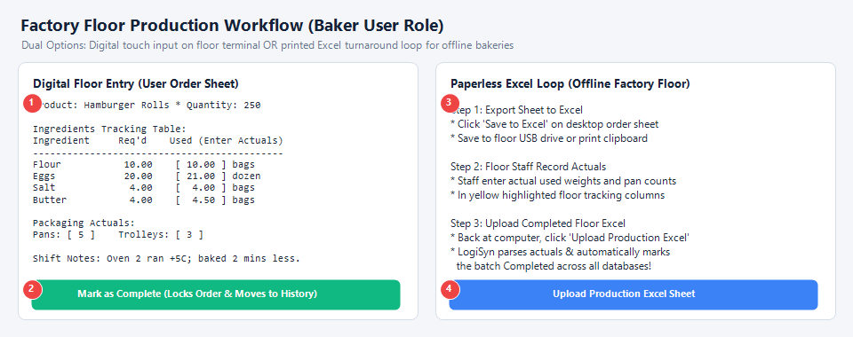
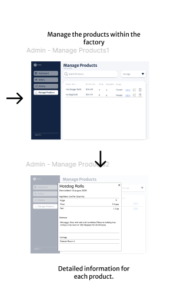
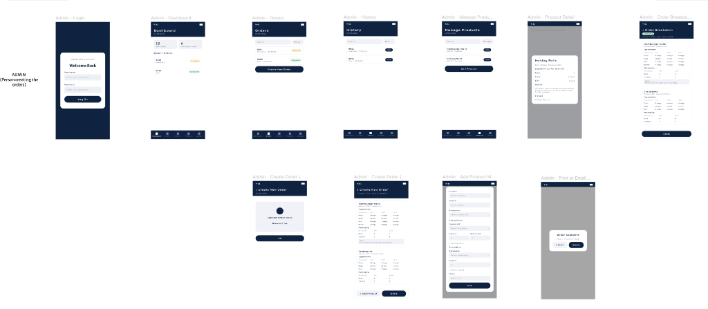
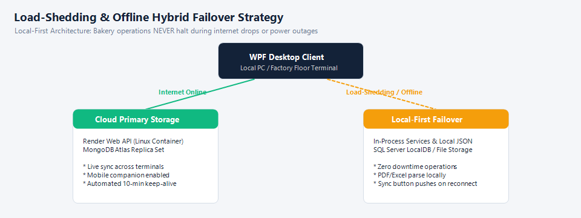

# Anderson's Bakery Management System (LogiSyn) — User Guide

<div align="center">
  
  &nbsp;&nbsp;&nbsp;&nbsp;&nbsp;&nbsp;&nbsp;&nbsp;
  
  <br><br>
  <strong>Empowering Factory Floor Operations with Simple, Automated, and Resilient Order Management</strong>
  <br>
  <em>Author: Anderson's Bakery Development Team &bull; Document Version: 2.0 (November 2026) &bull; Module Code: INSY7315</em>
</div>

---

## Executive Summary & System Overview

**LogiSyn** is a production management and workflow automation platform engineered specifically for **Anderson's Bakery** in Cape Town, South Africa. Anderson's supplies fresh, chilled, ambient, and frozen baked goods daily to major supermarket retailers, primarily **Checkers** and **Spar**.

Historically, supermarket purchase orders arrived as disparate PDF and Excel files, requiring manual transcription into physical logbooks. This created calculation bottlenecks, human error in baking pan and trolley load allocations, inventory discrepancies, and severe vulnerability to South African electrical load-shedding and internet outages.

LogiSyn automates this entire lifecycle into a **four-step digital workflow** backed by a **Local-First, Failover Hybrid Strategy**:

<div align="center">
  
</div>

1. **Order Ingestion:** Drag-and-drop customer purchase orders (.pdf, .xlsx, .xls, .csv).
2. **Automatic Scaling:** Automatic extraction of retail loaf counts, conversion into batch ingredients (with a 10% safety buffer), and calculation of required baking pans and trolleys.
3. **Factory Floor Tracking:** Real-time production tracking via interactive touchscreens or paperless floor Excel sheets.
4. **Resilient Synchronization:** Automatic persistence across local storage, SQL Server LocalDB, and cloud MongoDB Atlas with zero downtime during power or internet interruptions.

---

## Table of Contents

1. [Technical Requirements & System Prerequisites](#1-technical-requirements--system-prerequisites)
   - [Hardware Requirements](#hardware-requirements)
   - [Operating System & Software Dependencies](#operating-system--software-dependencies)
   - [Network & Cloud Connectivity Requirements](#network--cloud-connectivity-requirements)
2. [Foolproof Setup & Installation Guide](#2-foolproof-setup--installation-guide)
   - [Step-by-Step Desktop Installation](#step-by-step-desktop-installation)
   - [Initial Database Initialization & Verification](#initial-database-initialization--verification)
3. [User Roles & Permissions Matrix](#3-user-roles--permissions-matrix)
4. [System Access & Getting Started](#4-system-access--getting-started)
   - [Launching the Desktop Application](#launching-the-desktop-application)
   - [Default Login Credentials](#default-login-credentials)
   - [Password Security Upgrades](#password-security-upgrades)
   - [Understanding Connection Status Badges](#understanding-connection-status-badges)
5. [Application Navigation & Layout](#5-application-navigation--layout)
6. [Step-by-Step Module Guides](#6-step-by-step-module-guides)
   - [Module 1: Dashboard Overview & Quick Actions](#module-1-dashboard-overview--quick-actions)
   - [Module 2: Order Ingestion & Automatic Scaling Engine](#module-2-order-ingestion--automatic-scaling-engine)
   - [Module 3: Production Sheets & Manager Order Review](#module-3-production-sheets--manager-order-review)
   - [Module 4: Factory Floor Production Workflow (Baker Role)](#module-4-factory-floor-production-workflow-baker-role)
   - [Module 5: Order History & Quality Audit](#module-5-order-history--quality-audit)
   - [Module 6: Product & Recipe Catalog Management](#module-6-product--recipe-catalog-management)
   - [Module 7: User Administration & Cloud Synchronization](#module-7-user-administration--cloud-synchronization)
   - [Module 8: Reporting, Batch Excel Export & Email Dispatch](#module-8-reporting-batch-excel-export--email-dispatch)
7. [Mobile Web Companion Guide](#7-mobile-web-companion-guide)
8. [Offline Resilience & Load-Shedding Survival Strategy](#8-offline-resilience--load-shedding-survival-strategy)
9. [Comprehensive Troubleshooting & Frequently Asked Questions (FAQ)](#9-comprehensive-troubleshooting--frequently-asked-questions-faq)
10. [Quick Reference Cheat Sheet](#10-quick-reference-cheat-sheet)

---

## 1. Technical Requirements & System Prerequisites

To ensure reliable, fail-safe operation on both administrative terminals and dusty factory floor environments, verify that your client devices satisfy the following specifications.

### Hardware Requirements

| Specification | Minimum Specification | Recommended Specification (Factory Floor) |
| :--- | :--- | :--- |
| **Processor (CPU)** | Intel Core i3 (2.0 GHz) or AMD Ryzen 3 equivalent | Intel Core i5 (2.5 GHz+) or AMD Ryzen 5 quad-core |
| **Memory (RAM)** | 4 GB RAM | 8 GB DDR4 RAM (smooth multitasking with Excel/PDFs) |
| **Storage Available** | 500 MB free disk space | 2 GB SSD space (fast local database access) |
| **Display Resolution** | 1280 &times; 800 pixels | 1920 &times; 1080 (Full HD) touch-enabled monitor |
| **Peripherals** | Keyboard and mouse | Touchscreen monitor, barcode scanner (optional), USB flash drive |

### Operating System & Software Dependencies

* **Supported Operating Systems:**
  * **Desktop Client:** Microsoft Windows 10 (64-bit, Version 19041 or higher) or Windows 11 (64-bit).
  * **Mobile Web Companion:** Any smartphone or tablet running iOS 14+, Android 9+, macOS, or Linux.
* **Runtime Frameworks:**
  * **.NET 10.0 Desktop Runtime (x64):** Required for executing WPF desktop binaries. If not installed, the LogiSyn setup launcher will prompt you to download the official Microsoft runtime.
  * **Microsoft Edge WebView2 Runtime:** Pre-installed on Windows 11 and modern Windows 10 updates; used for rendering hybrid web and PDF preview components.
* **Local Database Engine:**
  * **Microsoft SQL Server 2019/2022 Express LocalDB:** Bundled with Windows developer tools or installed via the prerequisite package. Stores local offline cache (`LogiSynDb.mdf`).
* **Office & Productivity:**
  * **Spreadsheet Viewer:** Microsoft Excel 2016+, Office 365, LibreOffice Calc, or any OpenXML-compatible viewer for opening exported `.xlsx` production sheets.
  * **Email Client (Optional):** Microsoft Outlook (desktop application) for 1-click COM automated email attachments. If Outlook is absent, LogiSyn defaults seamlessly to standard webmail / system `mailto:` links.

### Network & Cloud Connectivity Requirements

* **Outbound Internet:** Standard HTTPS on **Port 443** outbound to:
  * Render Cloud API: `https://andersons-bakery-api.onrender.com`
  * MongoDB Atlas: `mongodb+srv://cluster0.9cst6.mongodb.net`
* **Local Failover:** If the network is blocked, unavailable, or interrupted by load-shedding, LogiSyn **automatically routes all operations to the local SQL database and in-process file storage without failing or displaying error crashes**.

---

## 2. Foolproof Setup & Installation Guide

### Step-by-Step Desktop Installation

Follow this 4-step sequence to install LogiSyn on any administrative or factory workstation:

```
[ Step 1: Pre-Check ] ──► [ Step 2: Extract/Install ] ──► [ Step 3: Run LogiSyn ] ──► [ Step 4: Verify Sync ]
```

1. **Step 1: Check .NET Runtime:**
   - Press `Win + R`, type `cmd`, and press Enter.
   - Run: `dotnet --list-runtimes`
   - Ensure `Microsoft.WindowsDesktop.App 10.0.x` is listed. If missing, download it from [https://dotnet.microsoft.com/download/dotnet/10.0](https://dotnet.microsoft.com/download/dotnet/10.0).
2. **Step 2: Obtain & Extract the Application Package:**
   - Download the official `LogiSyn-Setup-v2.0.zip` package from your management repository or local network share (`\\bakery-server\software\LogiSyn`).
   - Right-click the `.zip` file, select **Extract All...**, and extract to `C:\Program Files\LogiSyn\` (or `C:\LogiSyn\` for non-administrator user accounts).
3. **Step 3: Unblock & Create Desktop Shortcut:**
   - Open the destination folder. Right-click `LogiSyn.exe` &rarr; **Properties**.
   - If a security warning appears at the bottom ("*This file came from another computer...*"), check **Unblock** and click **Apply**.
   - Right-click `LogiSyn.exe` &rarr; **Send to** &rarr; **Desktop (create shortcut)**.
4. **Step 4: Launch LogiSyn:**
   - Double-click the desktop shortcut. LogiSyn will initialize its local database and present the login screen.

### Initial Database Initialization & Verification

Upon very first launch, LogiSyn inspects the workstation environment:
* It creates the local SQLite / SQL LocalDB file (`LogiSynDb.mdf`) in the application directory.
* It provisions default product catalogs (Hamburger Rolls, Hotdog Rolls, Croissants, Paninis, Chelsea Buns).
* It seeds initial administrative and staff accounts (`admin`, `manager`, `user`).
* It contacts the live cloud API at `https://andersons-bakery-api.onrender.com` to verify cluster synchronization.

> [!TIP]
> **Verification Test:** Once the login screen opens, verify that the upper right connection badge reads either **🟢 API Connected** (online) or **🟠 Local Storage (Fallback)** (offline). Both states confirm the application is 100% operational.

---

## 3. User Roles & Permissions Matrix

LogiSyn implements strict Role-Based Access Control (RBAC). Upon login, the interface automatically configures itself to present only the features relevant to the user's role:

| Feature / Screen | Administrator (`admin`) | Production Manager (`manager`) | Baker / Floor Staff (`user`) | Purpose & Security Constraint |
| :--- | :---: | :---: | :---: | :--- |
| **Dashboard** | Full Access | Full Access | View KPIs & Shift Tasks | High-level metrics and recent orders feed |
| **Orders View** | Full Access | Full Access | Active Production List | View pending and in-production customer orders |
| **Order Ingestion (PDF/XLS)** | ✅ Yes | ✅ Yes | ❌ Hidden | Parsing supermarket orders and scaling batches |
| **Production Sheets Review** | Read & Edit | Read & Edit | ❌ Replaced | Review scaled ingredients and pan/trolley allocations |
| **User Production Sheet** | Read-Only | Read & Edit | ✅ Interactive Input | Record actual ingredient consumption and actual pans used |
| **Upload Floor Excel** | ❌ Managed via Ingestion | ❌ Managed via Ingestion | ✅ Upload Floor Sheet | Paperless upload of handwritten or floor-marked sheets |
| **Order History & Quality Audit** | ✅ Full Search & Filters | ✅ Full Search & Filters | ❌ Hidden | Search historical completed orders and quality notes |
| **Product & Recipe Catalog** | ✅ Full CRUD | ✅ Full CRUD | ❌ Hidden | Create, edit, and delete products, ingredients, and shelf-life |
| **User Management** | ✅ Full CRUD & Cloud Sync | ❌ Hidden | ❌ Hidden | Create staff, reset passwords, and reconcile offline orphans |
| **Batch Export & Emailing** | ✅ Yes | ❌ Hidden | ❌ Hidden | Dispatch consolidated Excel sheets to retail liaisons |

---

## 4. System Access & Getting Started

### Launching the Desktop Application

1. Double-click the **LogiSyn** shortcut on your Windows desktop.
2. The **Login Screen** appears with a navy header and branded credentials box:
   - **Username:** Enter your allocated account name (e.g. `admin`, `manager`, `user`).
   - **Password:** Enter your confidential password.
   - **Show/Hide Password:** Click the **Eye Icon** (`eye-off.png`) on the right side of the password field to toggle character masking.
   - Click **Login** (or press `Enter`).

### Default Login Credentials

For initial setup, commissioning, and training, the system includes the following seed accounts:

| Role | Username | Temporary Password | Recommended Operational Usage |
| :--- | :--- | :--- | :--- |
| **Administrator** | `admin` | `admin123` | System configuration, staff user setup, catalog management, batch reporting |
| **Production Manager**| `manager` | `manager123` | Order scheduling, purchase order ingestion, production sheet adjustments |
| **Baker / Floor User**| `user` | `user123` | Floor terminal interaction, actuals logging, completing baking batches |

> [!IMPORTANT]
> **Automatic Password Security Upgrade:** When any user logs in with an initial password, LogiSyn automatically upgrades plain-text credentials to **PBKDF2-HMAC-SHA256 salted hashes with 600,000 iterations**. Default passwords should be changed immediately following commissioning via **Manage Users**.

### Understanding Connection Status Badges

In the top-right corner of the application window, an intelligent indicator pill displays real-time backend connectivity:

<div align="center">
  
</div>

* **🟢 API Connected (Green):** The application is communicating with the cloud backend on Render and MongoDB Atlas. Orders and user updates sync across all devices in real-time.
* **🔵 Calling API... (Blue):** A background network request or file upload is active. The user interface remains 100% interactive and will not freeze.
* **🟠 Local Storage (Fallback) (Orange):** The workstation is offline (internet outage, load-shedding, or cloud cold-start). LogiSyn routes all operations locally to SQL Server LocalDB and JSON files with **zero operational downtime**.
* *Clicking the Badge:* Click directly on the badge at any time to run an immediate live health probe and display a confirmation toast message.

---

## 5. Application Navigation & Layout

Once logged in, LogiSyn presents a clean, high-contrast desktop workspace designed for high visibility under industrial bakery lighting:

<div align="center">
  
</div>

### Annotated Screen Elements

* **[1] Role-Gated Sidebar:** Dark navy navigation panel (`#132238`) containing primary module buttons (`Dashboard`, `Orders`, `History`, `Manage Products`, `Manage Users`). Buttons are displayed strictly according to the logged-in user's role.
* **[2] Page Title & Date Header:** Displays the current module name along with today's date formatted to South African standard (`DD/MM/YYYY`).
* **[3] Real-Time Status & Role Pill:** Highlights the active user role and live cloud connection status.
* **[4] Primary KPI Cards:** High-level metrics displaying real-time counts of *New / Pending Orders* and *Completed Orders*.
* **[5] Executive Action Shortcuts:** Admin-only quick export buttons to generate Excel workbooks or compose emails to supermarkets.
* **[6] Main Workspace & Feed:** Dynamic working area hosting data grids, order sheets, and modal forms.
* **[7] Exit / Log Out Button:** Positioned in the upper right header to safely terminate the active session and return to the login screen.

---

## 6. Step-by-Step Module Guides

### Module 1: Dashboard Overview & Quick Actions

The **Dashboard** serves as the central operational hub for production supervisors and bakery managers.

#### Step-by-Step Instructions:
1. Click **Dashboard** on the left sidebar navigation.
2. Review the live production cards:
   - **New Orders:** Total orders awaiting baking or currently in production.
   - **Completed Orders:** Total orders finalized during the current shift.
3. Review the **Recent Orders Feed**:
   - Displays incoming orders sorted chronologically by order date.
   - Status indicators highlight order progress: `Pending` (amber), `In Production` (blue), or `Completed` (green).
4. Click on any recent order row to open its full production breakdown sheet immediately.

---

### Module 2: Order Ingestion & Automatic Scaling Engine

This module eliminates manual recipe calculations, pan requirements, and trolley allocations when orders arrive from retail supermarkets.

<div align="center">
  
</div>

#### Step-by-Step Instructions:
1. **Navigate to Orders:** Click **Orders** on the sidebar, then click the green **+ Create Order** button in the upper right.
2. **Ingest Order File:**
   - *Method A (Drag & Drop) [1]:* Drag the customer's PDF or Excel file from Windows Explorer and drop it onto the dotted drop zone.
   - *Method B (File Browser):* Click **Browse Files**, select the customer purchase order, and click **Open**.
   - Supported file formats: `.pdf` (standard Checkers and Spar purchase orders), `.xlsx`, `.xls`, and `.csv`.
3. **Process Order [2]:**
   - Click the green **Process Order (Go)** button.
   - LogiSyn parses the customer name (e.g. `Checkers Hyper Brackenfell`), purchase order number (e.g. `#CK-90214`), order date, and itemized product quantities.
   - **Automatic Collision Detection:** If an order with that purchase order number already exists in the database, LogiSyn automatically appends an incremental suffix (e.g. `#CK-90214-1`) to prevent data loss.
4. **Automatic Scaling Engine:**
   - **Baking Pans:** Calculated as $\lceil \text{Quantity} / 50 \rceil$ (e.g., 120 loaves require 3 pans).
   - **Baking Trolleys:** Calculated as $\lceil \text{Quantity} / 100 \rceil$ (e.g., 120 loaves require 2 trolleys).
   - **Raw Materials (10% Buffer):** Every recipe ingredient is scaled with an exact 10% safety buffer to account for bowl scraping, bench flour, and dough divider tolerance:
     $$\text{Scaled Ingredient Total} = \text{Base Recipe Qty} \times \frac{\text{Order Qty}}{\text{Recipe Yield}} \times 1.10$$
   - **Two Decimal Places Constraint:** All ingredient weights and volumes are strictly rounded to **at most 2 decimal places** (e.g., `92.50 kg`, `13.25 bags`) to prevent fractional confusion on the factory floor.
5. **Expected Result:** The application automatically navigates to the **Order Production Sheet** view with all values populated.

---

### Module 3: Production Sheets & Manager Order Review

Managers use the **Order Sheets View** to inspect, adjust, and approve scaled production before items move to the ovens.

#### The Dual-Sheet Layout:
* **Left Panel (Production Sheet) [3]:** Shows each ordered product, quantity, assigned production line (`Production 1`, `Production 2`, `Croissant Room`), calculated pans, trolleys, and operational notes.
* **Right Panel (Raw Material Scaling) [4]:** Displays the consolidated bakery-wide raw materials required for the batch (Flour, Yeast, Salt, Butter, Eggs, Sugar, Water) with the 10% safety buffer included.

#### Actions on this Screen:
* **Add Product on the Fly [5]:** Click **+ Add Product** to open the `AddMoreProducts` modal. Select any additional product from the catalog, specify the quantity, and both the pan/trolley counts and raw material totals will re-calculate automatically.
* **Save to Excel:** Click **Save to Excel** to export a clean, formatted `.xlsx` workbook of the production sheet.
* **Submit Order:** Click **Submit Order** to approve the sheet and push it into the active factory floor queue.

---

### Module 4: Factory Floor Production Workflow (Baker Role)

Designed for maximum clarity, high contrast, and rapid entry on factory floor touchscreens.

<div align="center">
  
</div>

#### Option A: Digital Touchscreen Workflow (On-Screen) [1]
1. The baker logs into the factory floor terminal using the `user` account.
2. The **User Orders** screen displays active, unfulfilled orders.
3. Click an order to open the interactive **User Order Sheet**:
   - The required ingredients and quantities are displayed.
   - As ingredients are measured into the mixer, enter the actual quantities used in the **Used** input column.
   - Record the actual number of pans and trolleys loaded into the ovens.
   - Enter any shift notes in the **Notes** box (e.g. "*Oven 2 ran 5°C hot; reduced bake time by 2 minutes*").
4. **Completing the Order [2]:**
   - Click the green **Mark as Complete** button at the bottom of the screen.
   - A confirmation popup will ask: "*Are you sure you want to mark this order as completed?*"
   - Click **Yes**. The order status updates to `Completed`, the sheet locks in read-only mode, and the record moves to History.

#### Option B: Paperless Excel Turnaround Loop (Offline Bakeries) [3, 4]
If your factory floor operates away from a computer screen:
1. Export the production order to Excel by clicking **Save to Excel**.
2. Staff record actual used quantities and pan counts directly into the yellow-highlighted columns of the Excel sheet on a floor tablet or clipboard.
3. Back at the terminal, the baker clicks **Upload Production Excel Sheet** on the User Orders screen.
4. LogiSyn automatically reads the recorded quantities and baker notes from the file.
5. The system asks: "*Do you want to mark this order as Completed now?*"
   - Click **Yes** to complete the order immediately.
   - Click **No** to review the digital sheet first.

---

### Module 5: Order History & Quality Audit

Accessible by **Administrators** and **Managers** for shift reviews, billing reconciliation, and quality auditing.

#### Step-by-Step Instructions:
1. Click **History** on the sidebar.
2. Filter past orders using the control bar:
   - **Search Bar:** Type any supermarket name, branch, or purchase order number.
   - **Date Range Dropdown:** Filter by **All Dates**, **Today** (current shift), **This Week**, or **This Month**.
3. **Inspect Completed Order Breakdown:**
   - Click the blue **View** link on any completed order row.
   - Opens the read-only **Order Breakdown** screen displaying exact quantities ordered, raw materials consumed, actual pan/trolley allocations, and timestamped baker notes.

---

### Module 6: Product & Recipe Catalog Management

Accessible by **Administrators** and **Managers**. Governs the recipes, storage classifications, and shelf-life parameters used by the automatic scaling engine.

<div align="center">
  
</div>

#### Browsing the Product Catalog:
* Displays all active products in a high-contrast data table: `Product Name`, `Price Per Unit`, `Sell By (Days)`, `Best Before (Days)`, and `Storage Location`.
* **Storage Filter:** Filter items by **Storage** (All), **Ambient** (breads, rolls, buns), **Chilled** (pastries, cream products), or **Frozen** (doughs, par-baked goods).

#### Viewing Product Recipe Details:
1. Click the blue **View** link on any product row.
2. The **Product Detail Modal** opens:
   - **Title & Metadata:** Displays the product name and date added (e.g. `Hotdog Rolls`, `Date Added: 10 August 2024`).
   - **Ingredient List Per Quantity:** Shows the exact base recipe ingredients and quantities separated by clean divider lines.
   - **Method:** Displays step-by-step mixing, proofing, oven temperature, and baking instructions.
   - **Storage:** Displays designated factory holding area (e.g. `Freezer Room 1`).
3. Click the **✕** button in the upper right to close.

#### Adding a New Product:
1. Click **+ Add Product** on the top action bar.
2. Enter the product specifications:
   - Product Name (e.g. `Artisan Sourdough Loaf 800g`).
   - Price Per Unit (R) (e.g. `24.50`).
   - Storage Location (`Ambient`, `Chilled`, or `Frozen`).
   - Sell By (Days) and Best Before (Days).
   - Preparation & Baking Method.
3. Configure Recipe Ingredients:
   - Enter Ingredient Name (e.g. `White Bread Flour`), Quantity (e.g. `0.50`), and Unit (`kg`, `bags`, `dozen`).
   - Click **+ Add Ingredient** to add additional line items.
4. Click **Save Product**.

#### Editing or Deleting a Product:
* **Edit:** Click the **Pencil Icon** to open the Product Detail Modal in editable mode. Adjust quantities or method notes, then click **SAVE**.
* **Delete:** Click the **Red Trash Icon**. A confirmation dialog appears: "*Delete [Product Name]?*". Click **Yes** to permanently archive the item.

---

### Module 7: User Administration & Cloud Synchronization

Accessible exclusively by **Administrators**. Governs staff credentials and cloud synchronization.

#### Adding a New User:
1. Click **Manage Users** on the sidebar.
2. Click **+ Add User** to open the creation dialog.
3. Enter the employee's **Username**, temporary **Password**, and select their role (**Admin**, **Manager**, or **User**).
4. Click **Save**.

#### The Orphan Reconciliation & Cloud Sync Button:
When user accounts or orders are created while the bakery computer is offline (or during load-shedding), they are saved locally to SQL Server LocalDB without an unassigned cloud identifier. These records are termed **Orphans**.

1. When internet connectivity is restored, click the **Sync** button in the top action bar.
2. LogiSyn scans for all local orphan accounts and pushes them to MongoDB Atlas.
3. A confirmation modal reports:
   > *"Sync complete: 2 users pushed to MongoDB, 0 skipped, 0 failed."*
4. All terminals and mobile devices can now immediately authenticate those accounts.

---

### Module 8: Reporting, Batch Excel Export & Email Dispatch

Accessible by **Administrators** from the Dashboard or Order Breakdown view.

#### Batch Exporting to Excel:
1. On the Dashboard, click **Export to Excel**.
2. The **Export Orders Modal** appears:
   - Select the checkbox beside each order to export, or click **Select All**.
   - The counter displays: e.g. *"3 of 12 orders selected"*.
3. Click **Export Selected**.
4. Choose the save location in Windows Explorer.
5. LogiSyn generates an OpenXML `.xlsx` workbook containing:
   - Executive order summary headers.
   - Itemized product breakdowns with pan and trolley allocations.
   - Raw material scaling sheets formatted for inventory reconciliation.

#### Dispatching Orders via Email:
1. On the Dashboard or Order Breakdown, click **Email Orders**.
2. In the modal, select the orders, enter recipient email addresses (comma-separated), and enter an optional cover note.
3. Click **Send Email**:
   - If **Microsoft Outlook** is installed, LogiSyn utilizes COM automation to create an email draft with the formatted Excel production sheets attached automatically.
   - If Outlook is absent, LogiSyn opens a standard system `mailto:` link with pre-populated subject and message body.

---

## 7. Mobile Web Companion Guide

LogiSyn includes a lightweight, zero-install mobile web companion designed for smartphones and tablets used directly on the bakery floor.

<div align="center">
  
</div>

### Access & Compatibility
* **Live Cloud URL:** `https://andersons-bakery-api.onrender.com`
* **Supported Browsers:** Google Chrome, Apple Safari, Microsoft Edge, Mozilla Firefox on iOS, Android, and tablets.

### Mobile Feature Tour (11 Connected Screens)
1. **Screen 1 (Mobile Login):** Sign in using your standard LogiSyn username and password. Quick role chips allow 1-tap testing.
2. **Screen 2 (Floor Dashboard):** Real-time summary cards displaying counts of New and Completed orders, plus a database status dot.
3. **Screen 3 (Orders View):** Searchable list with quick filter pills (`All`, `Pending`, `In Production`, `Completed`).
4. **Screen 4 (History View):** Searchable completed orders with date filters (`All`, `Today`, `Week`, `Month`).
5. **Screen 5 (Manage Products):** Mobile recipe catalog with storage category dropdown.
6. **Screen 6 (Product Detail Modal):** Full-screen recipe view showing ingredients per quantity, method, and storage location.
7. **Screen 7 (Order Breakdown):** Production breakdown displaying item cards, pans, and trolleys.
8. **Screen 8 (Create Order - Upload):** Ingest purchase orders directly from mobile storage.
9. **Screen 9 (Create Order - Sheets):** Review and adjust scaled production cards on mobile.
10. **Screen 10 (Add Product Modal):** Quickly add custom products and prices on the fly.
11. **Screen 11 (Print or Email Modal):** 1-tap action to email production orders or dispatch to network printers.

> [!NOTE]
> **24/7 Cloud Availability:** An automated keep-alive service pings the cloud API every 10 minutes to eliminate container sleep delays, ensuring immediate response times on mobile devices around the clock.

---

## 8. Offline Resilience & Load-Shedding Survival Strategy

Because bakery operations in South Africa cannot halt when power outages or internet disruptions occur, LogiSyn is built on a **Local-First, Failover Architecture**:

<div align="center">
  
</div>

1. **Local-First Writes:** Whenever an order is created, scaled, or completed, it is saved directly to local storage and SQL Server LocalDB **first** before background cloud replication is attempted.
2. **Local PDF & Excel Parsing:** PDF parsing with `PdfPig` and Excel generation with `ClosedXML` execute entirely in-process on the local PC. No internet access or cloud services are required.
3. **Automatic Fallback:** If internet connectivity drops, the system seamlessly routes queries to the local SQL database without user interruption.
4. **Re-Synchronization:** As soon as connectivity returns, clicking **Sync** pushes all local records to MongoDB Atlas.

---

## 9. Comprehensive Troubleshooting & Frequently Asked Questions (FAQ)

### Q1: The PDF order fails to parse or displays "Unable to parse order file."
* **Cause:** The supermarket sent a scanned bitmap image inside a PDF rather than a text-based digital PDF, or altered their column layout.
* **Solution:** Test the PDF by attempting to highlight text using your mouse in Adobe Acrobat or Edge. If text cannot be selected, the file is a flat scan. Request a digital copy from the supermarket, or use **+ Add Product** on the Order Production Sheet to enter the items manually.

### Q2: What should I do if the connection badge displays orange "Local Storage (Fallback)"?
* **Cause:** Internet connection is down, load-shedding is active, or the cloud API is completing a cold start.
* **Solution:** No action is necessary. LogiSyn is 100% operational in offline mode. You can continue creating orders, scaling batches, and completing production sheets. Click the badge once internet is restored to test connectivity.

### Q3: A staff account created on the desktop cannot log in on the mobile companion.
* **Cause:** The user was created while the desktop was offline and is stored as an local "orphan" record.
* **Solution:** Log in as Administrator on the desktop terminal, navigate to **Manage Users**, and click the **Sync** button. The account will upload to MongoDB Atlas and become immediately accessible on mobile.

### Q4: An order was uploaded twice by mistake. Did it overwrite the original?
* **Answer:** No. LogiSyn features automatic collision detection (`EnsureUniqueOrderId`). If order `#CK-90214` is imported again, LogiSyn automatically creates `#CK-90214-1`. You can safely view and delete the duplicate if unneeded.

### Q5: How do I recover or reset a forgotten user password?
* **Solution:** An Administrator can log in, open **Manage Users**, select the staff member, click **Edit**, and enter a new temporary password. When the user logs in, their password will automatically be upgraded to a salted PBKDF2 hash.

### Q6: Can I run LogiSyn without Microsoft Outlook installed?
* **Answer:** Yes. If Outlook is not detected, clicking **Email Orders** automatically generates a pre-formatted system `mailto:` link compatible with webmail providers (Gmail, Outlook Web, Yahoo).

### Q7: Why do ingredient quantities show at most 2 decimal places?
* **Answer:** To prevent fractional measuring confusion on the factory floor, LogiSyn strictly limits all scaled ingredient weights and amounts to at most 2 decimal places (e.g. `12.50 kg`).

---

## 10. Quick Reference Cheat Sheet

| Task | Step-by-Step Action | Screen / Location |
| :--- | :--- | :--- |
| **Log In** | Enter Username & Password &rarr; click **Log In** | Login Window |
| **Ingest New Order** | Click **Orders** &rarr; **+ Create Order** &rarr; Drag/Drop PDF &rarr; Click **Go** | Orders View |
| **Add Product on the Fly** | Inside Order Sheet &rarr; click **+ Add Product** &rarr; select item & quantity | Order Sheets View |
| **Save Production Excel** | Inside Order Sheet &rarr; click **Save to Excel** | Order Sheets View |
| **Record Actuals (Baker)** | Click **User Orders** &rarr; open order &rarr; enter used qtys &rarr; **Mark as Complete** | User Order Sheet |
| **Upload Completed Floor Sheet** | Click **User Orders** &rarr; click **Upload Production Excel Sheet** | User Orders View |
| **Search Historical Orders** | Click **History** &rarr; type search term or select date range filter | History View |
| **View Recipe Specifications** | Click **Manage Products** &rarr; click **View** on product row | Manage Products View |
| **Add New Bakery Recipe** | Click **Manage Products** &rarr; click **+ Add Product** &rarr; enter recipe &rarr; **Save** | Manage Products View |
| **Reconcile Offline Users** | Click **Manage Users** &rarr; click **Sync** button in header | Manage Users View |
| **Test Live Cloud Connectivity**| Click the **Connection Pill** in the upper-right header | Any Desktop Screen |
| **Access Mobile Companion** | Open browser on smartphone &rarr; navigate to `https://andersons-bakery-api.onrender.com` | Mobile Browser |

---

<div align="center">
  <small>LogiSyn Management System &bull; Anderson's Bakery &bull; Documentation Version 2.0 (November 2026)</small>
</div>
